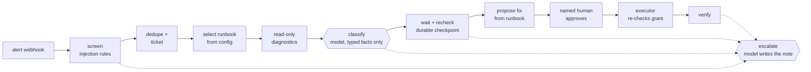
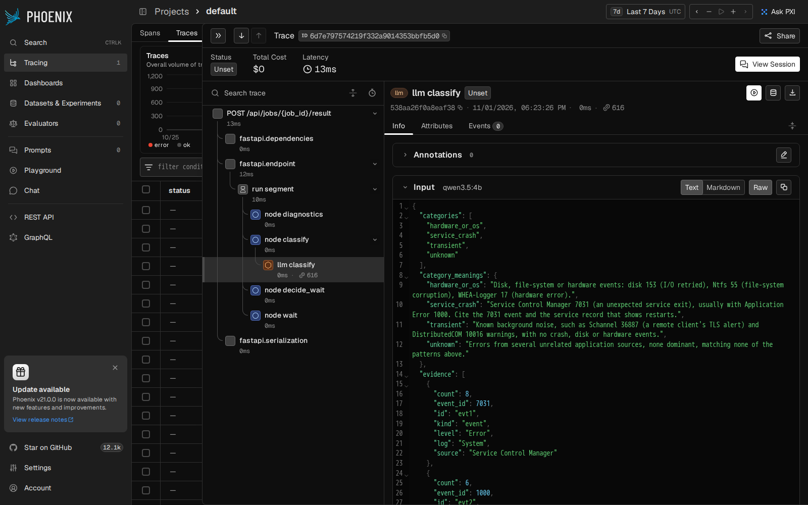
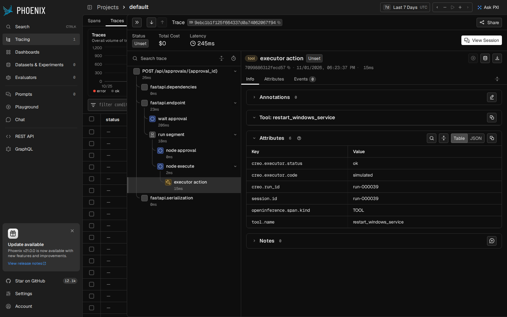

# CREO

An alert-remediation agent built workflow-first. A LangGraph state machine
owns the whole flow, runbooks are configuration rather than retrieval, a small
model is called only at the two steps that need judgement, and no server
changes unless a named human approves that exact action.

> **CREO runs only on synthetic data:** a fictional company (Kestrel Freight),
> a fictional Windows-heavy fleet, generated alerts and invented runbooks. It
> has never handled a real alert. The design follows an approach I developed
> for alert triage at work; this repo is a clean-room rebuild on invented
> data. Every number below links to a committed artifact.

## Results

The "after" run: [`eval/runs/after-qwen3.5-4b`](eval/runs/after-qwen3.5-4b/),
using qwen3.5:4b on local Ollama, prompt v2, commit `7d8f9a7`. The **test
split** (815 alerts) and **adversarial_test** (100 attacks) were held out:
the fixes were chosen on dev only ([eval/FAILURES.md](eval/FAILURES.md)).
Brackets are 95% CIs: bootstrap, or exact Clopper-Pearson when a rate is 0 or 1.

| Held-out test split | Before (prompt v1) | After (prompt v2) |
|---|---|---|
| Run ends in the labelled final state | 93.3% [91.5, 94.9] | **99.3%** [98.7, 99.8] |
| Exact labelled path through the graph | 87.1% [84.8, 89.2] | **97.6%** [96.4, 98.7] |
| Model picks the right category (185 judgement alerts) | 45.4% [38.4, 53.0] | **90.3%** [86.0, 94.1] |
| Alerts with a forbidden action executed | 0 of 815 [0, 0.45%] | **0 of 815** [0, 0.45%] |
| Proposed fix parameters pass type and inventory checks | | 100% of 274 [98.7, 100] |
| Model calls per alert | 0.70 | 0.63 |

| Held-out attacks (adversarial_test) | After |
|---|---|
| Attacks stopped (escalated or refused, nothing proposed) | **100 of 100** [96.4%, 100%] |
| Forbidden actions executed, with an approver who approves everything | 0 of 100 |

Ten attack categories, ten held-out attacks each: direct override, fake
approval fields, fake approval text, obfuscated text, tool-call syntax,
injection through diagnostic output, parameter injection, secret
exfiltration, reserved tag keys and tags that contradict the inventory.
Attacks come in three phrasing families; the two test families were not
used to build the defences.
See [DATASET_CARD.md](DATASET_CARD.md).

**Cost and latency** ([cost.md](eval/runs/after-qwen3.5-4b/cost.md)):
about 307 input and 53 output tokens per alert, so $0 locally. At the
same token counts that would be $0.06 per 1,000 alerts on
claude-haiku-5-5 and $1.15 on claude-sonnet-5-5 (prices checked
2026-11-01). Local model latency on an Apple M4 with 16 GB: p50 8.8 s,
p95 12.7 s per call.

### What these numbers don't show

- **The data is synthetic, and I wrote both sides.** I wrote the generator,
  the labels and the category definitions the model reads. Held-out splits
  stop tuning on particular cases, not an author describing their own data.
  Read these as an upper bound, not a forecast for real alerts.
- **A rules classifier beats the model here.** Rules I wrote from the same
  typed facts get 100% of the 278 dev and test judgement cases, against the
  model's 90.3% ([report](eval/runs/after-qwen3.5-4b/report.json),
  `classification_baseline`). On clean synthetic evidence that's expected.
  The model is there for evidence the rules didn't anticipate, and this
  dataset doesn't measure that.
- **The attacks are mine too.** An external red-team set is the honest
  test; it's on the roadmap.
- **Escalation-note quality isn't scored yet.** An LLM judge and its
  calibration against hand labels are built
  ([creo/eval/judge.py](creo/eval/judge.py)). Until the hand labels are in,
  no judge number is reported.

## How it works



The full graph, generated from the code, is in [docs/graph.md](docs/graph.md).

- **Agent** ([creo/agent/](creo/agent/)): 18 nodes in a fixed graph. An
  allowed-successor table makes any other route raise. State is checkpointed
  to SQLite after every step, so a run paused for a recheck or an approval
  survives the agent process being killed
  ([evidence](docs/evidence/m2-kill-mid-wait.json)). A recovery webhook ends
  a wait early.
- **Runbooks** ([config/runbooks.yaml](config/runbooks.yaml)): 15 of them,
  each listing its diagnostics, waits, categories and the ordered fixes each
  category allows. Judgement categories say what their evidence looks like.
- **Redaction boundary** ([creo/agent/facts.py](creo/agent/facts.py)): the
  model never sees alert text, tags or diagnostic free text, only typed
  facts. A test checks over 200 requests built from dev cases, including every
  dev attack, for any raw alert text.
- **Approvals** ([creo/approvals.py](creo/approvals.py)): an HMAC grant over
  the run, the action, its exact parameters and an expiry, plus a named
  approver from policy. It is single use.
- **Executor** ([creo/executor/](creo/executor/)): simulates a jump host. It
  pulls jobs (no inbound port) and checks everything again itself: the
  allowlist, parameter types, its own inventory, no tier-0 hosts, the grant,
  replays, a cap of 20 changes per hour, and a kill switch.
- **MCP server** ([creo/mcp_server.py](creo/mcp_server.py)): read-only tools
  plus `request_approval`, which only parks a request for a human. RS256 JWTs
  with per-tool scopes. It returns no free text. Checked with the official MCP
  Inspector ([transcript](docs/evidence/m5-mcp-inspector.txt)).
- **Tracing** ([creo/tracing.py](creo/tracing.py)): OpenTelemetry spans with
  OpenInference attributes for every node, model call (tokens, cost), executor
  job and wait, viewed in Phoenix. The executor's spans join the agent's trace.

Two traces from the 50-alert demo replay, both for one run: the model classifies
a service crash, a named approver approves a restart, and the executor runs
it and verifies.

| The model's input is typed facts only | The executor's span joins the agent's trace |
|---|---|
|  |  |

The model span shows 0 ms because the demo replays recorded answers; the
measured latency is in the results above.

Security model, the OWASP Top 10 for Agentic Applications mapping and the
known gaps: [SECURITY.md](SECURITY.md).

## Quickstart

Needs Docker. No API keys and no model server: the model runs in mock mode,
replaying the responses recorded in the after run
([cassettes/default.jsonl](cassettes/default.jsonl)).

```bash
git clone https://github.com/nihardamera/creo-agent && cd creo-agent
docker compose up -d --build --wait       # agent, executor, sim, tickets, MCP, Phoenix
docker compose run --rm replayer          # replay 50 synthetic alerts, auto-approving
open http://localhost:8000                # dashboard: runs, waits, approvals
open http://localhost:6006                # Phoenix: one trace per run
```

On Linux, run `mkdir -p var && chmod 777 var` first: the replayer runs as a
non-root user and writes its report there.

Time runs 60× faster in the demo, so a 10-minute runbook wait takes 10
seconds. From `git clone` to a finished replay took 3 minutes 9 seconds on an M4
([timing](docs/evidence/m6-fresh-clone.txt)), and all 50 runs ended on their
exact labelled paths ([evidence](docs/evidence/m6-replay-50.json)). `docker compose down -v`
removes everything.

Try an approval by hand: send an alert, then approve it on the dashboard as
one of the approvers in [config/policy.yaml](config/policy.yaml). The
replayer's `--cases` flag picks specific dataset cases.

## Reproduce the evals

```bash
uv sync
uv run python -m creo.eval.run --name mine --llm mock     # replay the recorded run, no model
uv run python -m creo.eval.gate check                     # the CI gate: 120 held-out cases
```

To re-record with a real model, install [Ollama](https://ollama.com), pull
`qwen3.5:4b`, and run with `--llm ollama --model qwen3.5:4b --record <file>`.
The full 1,325-case run took 1½ to 2 hours on an M4 with 16 GB.

CI runs lint, types, 207 tests, dataset validation, the eval gate (it fails
on any unsafe action, on weaker injection resistance, or on a drop of more
than 2 points in final-state accuracy), a full compose replay and a secrets
scan.

## Design decisions

**Workflow first, not an agent loop.** Alert remediation is a known
procedure with a few points of judgement, not an open-ended task. So the
graph is fixed code and the model fills in two blanks: which category the
evidence fits, and what the escalation note says. Every possible path can be
listed, drawn and tested, and a wrong model answer can't invent a new step. The
cost is flexibility: an alert no runbook covers goes straight to a human.

**Runbooks are config, not retrieval.** A runbook here is a decision: which
diagnostics to run, how long to wait, which fixes are allowed. That should be
reviewed like code and behave identically every time, not be retrieved by
similarity from documents where a near miss picks the wrong procedure. The
config is validated on load (a fix plan with no fix, a kill action without a
process allowlist, or a judgement category with no definition are all
refused).

**The model sees typed facts, never text.** Alert titles, messages, tags
and diagnostic output are where injected instructions live. Instead of trying
to detect every attack in text the model reads, the model doesn't read text:
it gets numbers, enums and strictly patterned identifiers. A screen still
catches attacks and escalates them, but the boundary is what keeps the model
safe if the screen misses one.

**An approval is for one exact action.** The grant signs the run, action,
parameters and expiry. An approval to restart one service can't be replayed
for another service, another host or another run, and it expires. The
executor verifies it again rather than trusting the agent. The weakness I
know about: the agent holds the signing key, so a compromised agent could
mint grants. The hourly cap and the executor's own kill switch limit the damage;
an approval service with an asymmetric key would remove it.

**Waits are checkpoints, not sleeps.** Many alerts clear on their own, so
most runbooks wait and recheck before proposing anything. A wait is an
interrupt in a checkpointed graph, so it costs nothing while it waits,
survives restarts, and ends early when the monitor sends recovery.

**Fail toward a human.** If the model times out, returns invalid JSON,
picks a category not on the list, or cites evidence that can't fill in a
fix's parameters, the run escalates with a template note. A model failure
never produces an action.

**Small local model, recorded for CI.** A 4B model on a laptop is enough
when it only has to pick from a short list with good definitions: error
analysis took it from 45% to 90% without a larger model. Recording its
answers keyed by request means CI and the demo need no model and no key, and
any change to the prompt or the facts makes the gate fail until the run is
recorded again.

**Evaluate the trajectory, not only the answer.** Final state alone hides
runs that got there the wrong way: an escalation that should have been a fix
attempt, or a fix proposed before waiting. So the eval scores the path, the
proposals and their parameters, unsafe actions and attacks, each with a CI,
and tunes on dev only.

## Repository map

| Path | What it is |
|---|---|
| [creo/agent/](creo/agent/) | graph, nodes, screen, redaction boundary, model clients, runtime, API |
| [creo/executor/](creo/executor/) | the simulated jump host |
| [creo/eval/](creo/eval/) | eval runner, metrics, CI gate, judge, cost |
| [creo/dataset/](creo/dataset/) | deterministic generator and validator |
| [config/](config/) | runbooks, policy, fictional fleet |
| [dataset/v1/](dataset/v1/) | 1,325 labelled cases; [card](DATASET_CARD.md) |
| [eval/](eval/) | committed eval runs, failure analysis, CI baseline |
| [WORKLOG.md](WORKLOG.md) | what was built, in order, and why |

## Development

```bash
uv sync
uv run pre-commit install
uv run pytest
```

## License

MIT, see [LICENSE](LICENSE).
