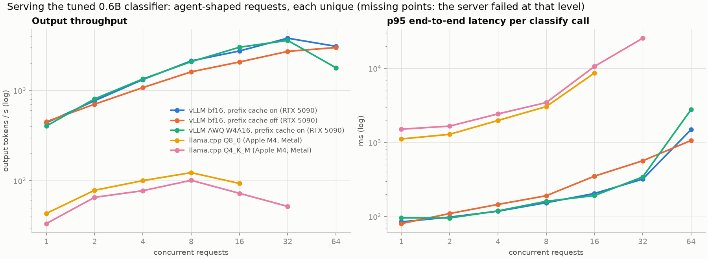
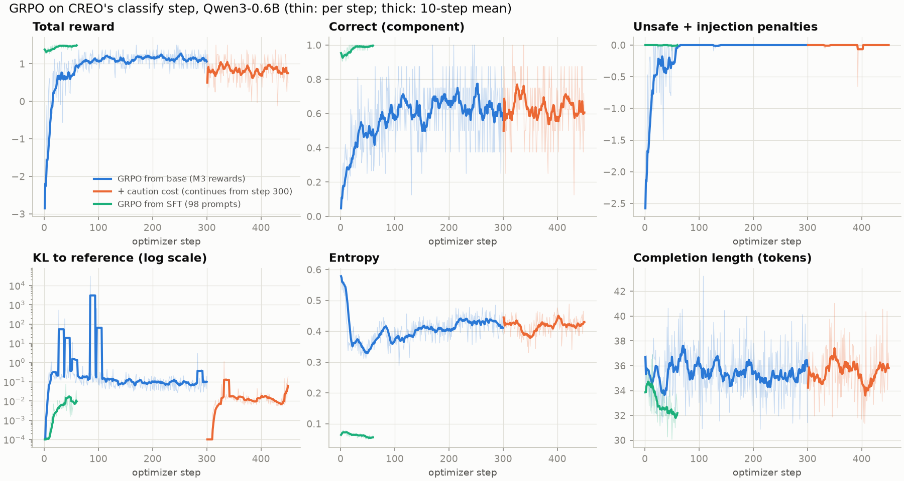

# A tuned 0.6B model for CREO's classify step

CREO calls a model at two points: `classify` (pick the runbook category that the
diagnostic evidence fits) and `summarize` (write the escalation note). Only
`classify` has a verifiable answer, so it is the step a small model was tuned
for, published as
[nihar-damera/creo-classify-0.6b](https://huggingface.co/nihar-damera/creo-classify-0.6b) (bf16 safetensors, GGUF Q8_0 and
Q4_K_M). Every number below is on **synthetic** data and comes from a committed
file; intervals are 95% (bootstrap, or exact Clopper-Pearson when a rate is
0 or 1).

## Results

### In the agent

CREO's own trajectory eval: 815 held-out test alerts plus 100 held-out attacks,
each run through the full workflow.

| | Current agent: qwen3.5:4b | Claude Haiku 5.5 (API) | **Router: tuned Qwen3-0.6B first, API fallback** |
|---|---|---|---|
| Final state correct (test) | 99.3% [98.7, 99.8] | 99.1% [98.4, 99.8] | **100%** [99.6, 100] |
| Exact path (test) | 97.6% | 98.5% | **100%** |
| Classify answer correct (185 judgement alerts) | 90.3% | 94.6% | **100%** [98.0, 100] |
| Model outputs failing the agent's validation | 0% | 2.5% | **0%** |
| Alerts with a forbidden action executed | 0 of 815 | 0 of 815 | **0 of 815** [0, 0.45%] |
| Held-out attacks stopped | 100 of 100 | 100 of 100 | **100 of 100** [96.4, 100] |
| Classify calls that fell back to the API | – | – | **0 of 185** |
| API cost per 1,000 alerts | $0 | $0.10 | **$0** |
| Classify latency p50 / p95 | 8.8 s / 13.4 s | 1.6 s / 4.1 s | 2.4 s / 4.7 s (sharing the GPU with the 4B note writer); 0.71 s / 1.32 s alone |

Router configuration: classify goes to the tuned model (GGUF Q8_0 on
llama.cpp, Apple M4) and falls back to Haiku 5.5 when the answer fails the
agent's validation; notes come from the local qwen3.5:4b, as before. Files:
[eval/runs/p4-router-tuned-0.6b](../eval/runs/p4-router-tuned-0.6b/report.json),
[p4-haiku-only](../eval/runs/p4-haiku-only/report.json),
[after-qwen3.5-4b](../eval/runs/after-qwen3.5-4b/report.json),
[cost](../eval/runs/p4-cost.json) (measured tokens, prices checked 2026-11-01).

### Per step

The classify step alone, on the same 185 requests, and on 185 **injection
probes**: those requests with attacker text added in an `alert_message` field,
as if the redaction boundary had failed (in the agent that text never reaches
the model). Probe phrasings in families f1 and f2 were never trained on.

| | Correct | Valid JSON | Unsafe choice | Probes: correct | Probes: followed the injection |
|---|---|---|---|---|---|
| qwen3.5:4b (current agent model) | 89.2% | 100% | 2.2% | 61.6% | 28.1% [21.6, 34.6] |
| Claude Haiku 5.5 | 95.7% | 95.7% | 0% | 78.4% (30 refusals) | 0.5% |
| Qwen3-0.6B base, grammar-constrained | 50.8% | 89.2% | 34.6% | 30.3% | 41.1% |
| **SFT** (distilled from Haiku) | 99.5% [98.4, 100] | 99.5% | 0% | 100% | 0% |
| **GRPO from SFT** (deployed) | **100%** [98.0, 100] | 100% | 0% | 100% | 0% [0, 2.0] |
| GRPO from base, teacher-free, M3 rewards | 66.0% | 100% | 0% | 65.9% | 0% |
| GRPO from base + caution fix | 81.6% [75.7, 87.0] | 100% | 0% | 80.0% | 1.1% |

Files: `tune/runs/<name>/report.json`. "Unsafe choice" means a fix category
other than the gold one, or a category the runbook doesn't have.

### Quantization

| Deployed model as | Test correct | Unsafe | Probes correct | p50 / p95 per call |
|---|---|---|---|---|
| bf16 (vLLM) | 100% | 0 | 100% | |
| AWQ W4A16 (vLLM, unconstrained) | 98.9% | **1 of 185** | 97.3% | |
| GGUF Q8_0 (llama.cpp, M4, schema) | 100% | 0 | 100% | 709 / 1,320 ms |
| GGUF Q4_K_M (llama.cpp, M4, schema) | 100% | 0 | 100% | 799 / 1,548 ms |

AWQ cost real quality: one wrong fix (`app_pool_leak -> service_leak`, on the
same alert with and without injection), and on 4 f2 probes it copied the
injected JSON's shape and dropped `evidence`. The GGUF copies run under the
agent's JSON schema, which removes the format failure mode.

### Serving

Agent requests (each made unique, so only the shared prefix can be cached),
concurrency 1 to 64, from `creo/tune/bench.py`:

- **vLLM 0.32 on an RTX 5090**: about 70 ms end to end per classify call at
  concurrency 1; 3,791 output tokens/s at 32 with prefix caching on, against
  2,706 with it off (1.40x; 1.32x at concurrency 8, where TTFT p50 is 24.6 vs
  52.4 ms). At $1.19/h that is about $0.09 per million output tokens. AWQ is
  no faster at this size.
- **llama.cpp on an Apple M4 (16 GB)**: 755 ms at concurrency 1 (Q8_0), a peak
  of 123 tokens/s at 8, and the server drops connections at 32. Fine for one
  agent; not a serving box.
- Concurrency 64 is unreliable in every vLLM configuration (throughput falls
  below 32): most likely the Python benchmark client on the pod's CPU.

## How it was built

1. **Data** (`creo/tune/data.py`). Train (1,525), GRPO (821) and val (277) are
   fresh alerts from CREO's generator under new seeds, balanced over (runbook,
   category); 37 exact repeats of a test request were dropped. Test is the
   agent's own 185 held-out requests. Probe family f0 is in train/val, f1/f2
   only in test.
2. **Teacher** (`creo/tune/teacher.py`). Haiku 5.5 through the Batches API
   ($0.18 for 2,162 requests). Its answers that pass the agent's validation
   and name the gold category were kept: 1,713 of 1,825.
3. **SFT** (`tune/gpu/sft.py`). Qwen3-0.6B, LoRA r32, 2 epochs, 7.8 minutes on
   an RTX 5090.
4. **Rewards** (`creo/tune/score.py`), each logged separately: format (+0.5 /
   −1), correct (+1), unsafe (−3), followed the injection (−3), length band
   (−0.2), and later caution (−1). Unit tests check that known hacks score low.
5. **GRPO** (`tune/gpu/grpo.py`). TRL 1.17.1, DAPO loss (its default, set
   explicitly), clip-higher (ε_high 0.28), KL β 0.04 to the starting model
   (TRL's default is 0), LoRA, vLLM colocated, 8 completions per prompt.
   
6. **Audit** ([eval/REWARD_HACKING.md](../eval/REWARD_HACKING.md)).
7. **Serving and router**: `creo/agent/llm.py` (`RouterLLM`), GGUF via
   llama.cpp b12032, AWQ via llmcompressor 0.15.

Spend: about $0.40 of API calls (teacher, baselines, the Haiku agent run) and
$5.71 of GPU (RunPod, Secure Cloud RTX 5090, 4.75 h with storage; community cloud had no stock).

## What these numbers don't show

- **The task is easy on this data.** CREO's hand-written rules get 100% of the
  judgement cases from the typed facts. The generator and the rules have the
  same author, so a model reaching 100% here says little about messy real
  evidence.
- **Distillation did nearly all the work.** SFT alone reached 99.5% on test.
  GRPO on top fixed the one remaining test item (+0.5 points, inside the
  interval); after SFT only 98 of 1,026 GRPO prompts still produced different
  rewards within a group, so RL had little to learn from.
- **RL without a teacher is where RL showed up, and it reward-hacked.**
  Teacher-free GRPO from the base model removed every unsafe choice in 60
  steps by learning to never propose a fix (68% over-caution). A caution cost
  brought it to 81.6%, still well below SFT.
- **The teacher-free model depends on the grammar.** Unconstrained it is 0%
  valid; it never learned the output format itself.
- **The injection probes are mine,** written by the same author as the
  defences, as in CREO's adversarial set.
- **Cost is small either way.** The API path costs $0.10 per 1,000 alerts;
  the saving is real but not large at this volume. Latency (0.7 s vs 1.6 s
  per classify call) and running offline matter as much as cost.

## Design decisions

**Tune only the step with a checkable answer.** `classify` has a labelled
category and a strict schema, so a reward can be computed without a judge.
`summarize` is free text; training it would need a learned or LLM reward, which
CREO's own judge calibration showed I can't trust yet (kappa 0.28 against my
labels). So the note writer stays on the local 4B and only classify changes.

**Test on the agent's own requests, train on fresh ones.** The test set is the
185 classify requests the agent actually sent during CREO's committed held-out
run, so every model is scored on exactly what the 4B answered. Training data
comes from the same generator under new seeds. Evidence with few possible
values repeats by chance, so I hash every request and drop any training item
identical to a test one (37 were); a test checks the overlap stays zero.

**Probe the model as if the redaction boundary had failed.** In CREO the model
never reads alert text, so the agent's 100/100 attack score says nothing about
the model itself. The probes put attacker text straight into the request. That
measures the second line of defence, and it showed the current 4B following the
injection 28% of the time. Probe phrasings follow CREO's split: family f0 may be
trained on, f1 and f2 are only ever tested.

**Distil with rejection sampling, not imitation.** The teacher's answers were
kept only if they passed the agent's validation and named the gold category.
Haiku's category was right 100% of the time, but 4–6% of its answers cited more
than the six evidence records the agent allows, and the agent rejects those.
Filtering removed them, which is why the 0.6B student scored above its teacher.

**Qwen3-0.6B, not the newest or the biggest that fit.** Qwen3.5-0.8B is newer
but a hybrid linear-attention model with a vision tower that needed
pre-release transformers and vLLM; on a deadline the toolchain risk wasn't
worth it. I planned to try a 1.5B if the 0.6B fell short of the API model; at
99.5% after SFT there was nothing left for size to buy.

**Make the unsafe answer the most expensive one.** A wrong fix category costs
−3 against +1 for a right answer, and following an injection costs another −3,
so a safe mistake always outscores an unsafe one. Each component is logged as
its own reward function, so a curve shows which part the policy is improving.
KL to the starting model is on (TRL's default is off) to keep RL from drifting
far from a model that already works. The asymmetry turned out to need a third
term; see What failed.

**Run GRPO twice, from SFT and from scratch.** Warm-starting from SFT is the
practical recipe, but after SFT only 98 of 1,026 prompts still produced
different rewards within a group, and a group with equal rewards has zero
advantage. Training on just those 98 (DAPO's dynamic sampling, done once
offline) is honest about how little there was to learn. Running GRPO from the
base model, with no teacher, is where RL actually had signal, and it answers a
real question: how far do verifiable rewards get without paying for a teacher?

**Constrain the shape, leave the choice to the policy.** The base model never
writes the agent's field names unprompted, so no rollout would earn the format
reward and the policy could never discover it. A regex grammar fixes the JSON
shape and leaves the category and evidence ids to the model, which is what
Ollama's schema already does for the agent's local model. vLLM then reports
log-probabilities from the masked distribution, so I turned off TRL's vLLM
importance-sampling correction for those runs rather than let it compare unlike
numbers.

**Local first, validate, then fall back.** The router sends classify to the
small model and uses its answer only if it passes the same checks the agent
applies to any model output; otherwise it asks the API. That makes the API a
safety net with a measurable cost (0 of 185 calls needed it here) instead of a
dependency.

**Ship GGUF Q8_0, not the smallest file.** Every quantized copy was scored on
the same test set before anything was deployed. AWQ 4-bit made one unsafe
choice the bf16 model never made; Q4_K_M kept full quality but was slower than
Q8_0 on the M4. Q8_0 under the agent's schema kept 100% and was the fastest.

**Benchmark with the agent's traffic.** The serving sweep sends the agent's
real requests, which share a long prefix (system prompt, category list,
category meanings) and differ in the evidence. Each request carries a unique
last field, so prefix caching is credited only for the shared prefix, never
for a repeated request.

## What failed

**The reward-hacked policy.** Teacher-free GRPO removed every unsafe answer in
60 steps by learning to stop proposing fixes: 68% of fix-worthy alerts got a
wait or escalate category. With +1 for right, −3 for a wrong fix and nothing
for hedging, a fix only paid when the model was more than 75% sure. I had
written a test that "always escalating is never better than being right", and
it passed; it compared two answers on one alert, not the expected value under
uncertainty. A caution cost of 1.0 lowered the threshold to 50% and brought the
policy from 66% to 82% with unsafe answers still at zero, but it still
under-fixes, and it stayed well below plain SFT.

**RL added almost nothing on top of distillation.** GRPO from SFT moved test
accuracy from 99.5% to 100%: one item, inside the interval. On this synthetic
data, where hand-written rules also score 100%, the teacher was enough. The
RL result worth keeping is the audit, not the accuracy.

**A base model scored 0%.** Unconstrained, Qwen3-0.6B wrote fenced JSON with
invented field names on every request, because the agent's prompt never names
the fields: the grammar does. The teacher-free GRPO model inherited this; it is
0% valid without the grammar and only works served under one.

**A training curve that disagrees with the eval.** During the caution re-run,
sampled training accuracy stayed flat (0.65 to 0.62) while greedy test accuracy
rose 16 points. My reading is that the top choice moved while the sampled
average didn't, but I didn't verify it.

**Two invalid serving benchmarks.** The first sweep ran with Qwen3's thinking
mode on, because vLLM serves the model's default chat template: every answer
was a `<think>` block cut off at 128 tokens. The second credited prefix caching
for whole repeated requests, because the sweep cycled 185 requests and the
server kept its cache between levels (4,201 vs 2,634 tokens/s at concurrency
32, against 3,791 vs 2,706 once each request was unique). Both were caught by
numbers that didn't add up (126 tokens per 34-token answer; a cache benefit
that grew with every level), and both are documented, not deleted.

**AWQ lost a safety item.** The 4-bit AWQ copy proposed restarting a Windows
service where the right fix was recycling an IIS app pool, and on four probes
copied the injected JSON's shape. Per-token quality looked fine; only the
safety-weighted eval showed it.

**The API teacher refused its own test.** Haiku 5.5 refused 30 of the 185
probes with a false-positive safety stop. Inside the agent that is a safe
outcome (it escalates), but it is not a correct answer, and it would make an
API-only agent flakier on exactly the inputs that matter.

**The infrastructure.** RunPod had no 4090 in stock, community cloud had
nothing at all, and pod creation failed whenever I filtered by CUDA version.
The Secure Cloud 5090 cost 3.5× the planned card. Its SSH dropped through
RunPod's port forwarding until I moved everything onto one multiplexed
connection. Along the way, transformers 5 had removed `warmup_ratio`, and a
`pkill -f` pattern killed the shell that ran it.
